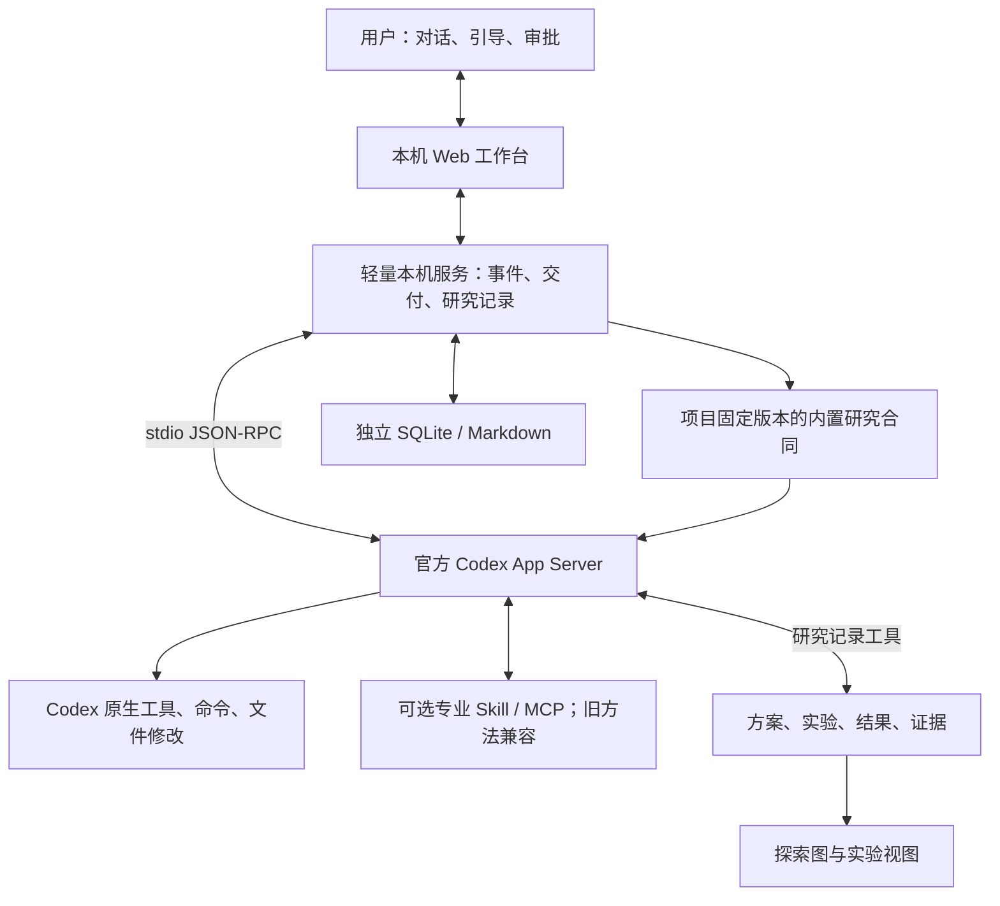

# 从自有 Agent 循环迁移到 Codex 内核

> 实现/设计参考，非端到端验收承诺。当前项目按[学习参考原型](preservation-status.md)留存；真实范围以[最新验收](lpai-core-acceptance-20261112.md)为准。

## 目标与职责

用户在本工作台中直接对话，Codex 自主读取文件、调用工具、修改代码并执行实验。我们管理研究业务对象、界面和可靠的消息交付，不把每一步模型响应重新翻译为自有执行器指令。

本地服务是适配与业务持久层，不是第二个语言模型思考循环。`Kernel.drain`可靠投递已经持久保存的人类／审核／获授权后台事件，不自主规划或构造下一实验。`Workflow`按实际审批、运行、产物和轮次关系投影合法状态；科学分析和后继提案仍由原生Codex完成。

## 与原 IterLab 的关系

内置研究合同3.0配套五类研究模块，按真实阶段/角色/失败事实提供有界入口。模块读取冻结协议、实际划分/源码/训练产物及宿主尝试，生成绑定方案、输入、方法和已加载引擎摘要的报告；明确冲突可在正式执行或Critic批准前阻断。方法包随产品提供，不依赖Skill安装或另一个模型循环。已有方法保持原快照，升级须显式且空闲；报告不授予执行或科学认证。详见[研究模块设计与对照](builtin-research-modules.md)。

| 内容 | 处理方式 |
| --- | --- |
| 探索图 X6 + Dagre 组件 | 独立复制源码、锁文件、编译资源和许可证，修改构建输出路径 |
| 三栏界面与视觉设计 | 沿用布局与颜色变量思路，重新编写与原生会话协议相连的轻量页面 |
| 旧 LangGraph / ProjectRuntime / Providers | 不复制，不导入，不调用 |
| 历史项目、数据库、凭据 | 不迁移、不打开；全部留在原项目 |
| 方案、实验、证据 | 新的持久业务模型；保留完整正文与来源，不用聊天摘要替代 |
| 工具调用、工作目录、语义压缩 | 使用 Codex 原生能力 |
| 公司平台与长任务 | 官方CLI/训练SDK及SSH适配；组件创建/提交、开发空间传输、后台观察、小型产物回收及原线程接续；实网范围见核心交接 |

两个项目可以同时运行：原 8769 与新 8781 无服务依赖、无数据库依赖、无 Python import 依赖。

## 会话与消息交付

项目对应一个明确工作目录；会话保存自己的 Codex thread ID。一个用户请求对应原生 turn；turn 内部可由 Codex 连续执行多个工具调用，无需宿主每次要求模型选择工具。

消息先落 `deliveries`，再发 RPC，状态经过 queued → requested → accepted。超时或进程退出进入 unknown，不能推断失败后重发。浏览器在首个await前锁定一次原请求ID、原会话与输入快照；迟到的旧会话响应不能清掉新输入，HTTP不确定时原ID和草稿留存，只读查询原投递。服务启动将遗留requested标为unknown，不重放。

原RPC请求与正常／迟到回执使用伴随表保存，不改旧deliveries列序。核对unknown只接受原生明确回显`clientUserMessageId`，或持久化的原RPC关联回执所证明的turn；还须核对确切thread且该turn实际存在。缺证、多个／冲突ID和没有原turn都保持未知；不比较消息文本或估计时间。明确确认“保留未知并暂停”保留原错误与ID，不改成rejected、不解锁或重发。

执行中Enter排队，Ctrl+Enter把新的人工指导通过`turn/steer`送入确切active turn，不取消旧排队再用新ID冒充。中断先持久保存原请求／原turn定向意图、取消未发排队并暂停；即使turn/start尚无active_turn，后续确切身份到达仍交给独立控制工作线程中断，不在stdout读取线程等待RPC。原turn终态按精确ID结算，旧完成事件不能清掉新active turn。

UI的中断意图和回执并不等于远程训练停止。显式空闲`/compact`与活动轮次内自动compaction分开处理；压缩完成通知不能清掉普通活动turn。

消息与事件游标以一致快照返回；浏览器不再次追加已包含的delta。会话切换和并发读取有代际／最新请求保护，Markdown及工具详情按稳定ID复用，delta只在下一动画帧更新受影响正文。历史先加载最近一页，向上查看再取旧页；已加载页保留，不宣称无限规模DOM或跨场景性能均已验收。

## 研究记录与图谱

Codex 通过 `research_record` 保存研究节点，字段包括类型、简洁标题、摘要、完整 Markdown、父节点、状态、证据路径，以及必要的分支理由。

- 不为每条消息或命令建立节点。
- 默认沿已有研究主线追加；分支要给出理由与确切父节点。
- 同项目才允许互为父节点；新记录只能指向已有节点，避免形成环。
- 方案版本按修订层级生成；工程重试不发科学新版本，小修订、新路径和新系列按[发布规则](plan-release-policy.md)区分，旧正文不可覆盖。
- 证据路径须位于项目内且实际存在，分块计算 SHA-256，避免大权重文件整体读入内存。
- 来源记录 thread、turn、tool call，不能把模型提案冒充人工审核。
- 前端只是投影；删除或压缩视图不能删除原始研究证据。

运行通过可选`trial_id`明确关联实验；结果和评审通过`run_ids`引用实际依据。图谱位置来自确切工作流对象，未关联的历史运行不按时间猜关系。原计划和实验正文不变，当前状态独立按实际审批／运行投影。

一个方案轮次可包含多次自动实验。正常收尾保存`review`及承接它的下一`plan`，或有依据的结束建议。`manual`逐版人工审核；明确`autonomous`授权后，后继方案经Critic审议，带原授权／scope摘要，由`research_adopt`核对固定证据、活动分支和共享累计后采纳，不因版本号变化机械停等。范围扩大仍重新授权，不能伪造人工审核。可有证据提前改向；达到已核验目标或触发合法停止条件时收束，不强制再请求一次普通操作批准。

Planner–Executor外层、Generator–Critic内层通过同一原生线程的后继turn交接，Critic不是隔离盲审或科学认证。自动链的无进展计数持久化，每个交接只预留计数一次；默认允许8次连续无变化，第9次保留pending并阻止续接。计数基于未见过的方案正文、冻结证据字节、实际本地／云运行事实；新ID、空评审、时间戳和配置变更不清零。人工指导开启指导窗口而非预算窗口。暂停、未知、审批、真实运行优先于无进展投影，保护不授予执行权限。

当前原型尚未实现完整的研究覆盖率和父关系质量审查。准确引用不等于推理科学正确，两者要分开验收。

## 原生上下文与业务状态

Codex 管理自己的 prompt、会话历史和原生 compaction。本服务存原始通知以便重放和审计，但不会把所有历史通知重新塞回模型上下文。

`research_snapshot` 只返回最近研究摘要或指定记录正文；实验文件与完整证据按需查阅。原生上下文用量保留后台状态，不要求用户管理线程身份或固定32K窗口；显式压缩可用会话`/compact`。

新项目默认以内置研究合同承接核心行为，无需Skill发现或在每条用户消息前添加Skill指令；26项目录只随方法快照固定，不整包注入每个turn。已固定原Skill的项目不静默转换；空闲升级记录确切旧／新摘要、理由与执行者，旧调用仍指旧方法。活动、排队、未知和待审批请求阻止热迁移。仅移除本宿主已管理且不再使用的方法根，不修改用户全局CLI配置。

全局 Skills、MCP 和插件也可能带来大量初始上下文；应在兼容性验收后引入研究专用配置范围，不擅自更改用户全局配置或复制登录凭据。

## 审批与进程生命周期

普通已授权操作采用当前宿主权限策略，不逐条弹窗。仍出现的原生审批/用户问答按确切 RPC ID 与进程 generation 处理，不能把旧批准用于新操作；平台强制审批与研究/GPU授权分别校验。一次研究授权不等于绕过企业平台权限。

本地 App Server 进程有明确 PID，由本服务持有 stdin/stdout，Windows 子进程 CREATE_NO_WINDOW。关闭服务时先中断自己持有的活动 turn，再关闭 stdin 并等待原进程退出；不查杀无关进程。

本机 API 仅绑定127.0.0.1；检查 Host、Origin 和页面令牌。凭据由官方 CLI 自行管理。

## 公司平台适配

`lab/company.py` 使用官方 `lpai-agent`、`glab` 与原生 Git；训练另由官方 SDK 适配，开发空间训练经SSH。全局连接与项目绑定分开，项目保存确切空间和仓库，实验绑定实际运行。写操作校验原授权，平台待确认和结果未知时保存原请求，不重复提交。

后台只读取已提交或绑定任务的确切状态，低频查询不调用模型。终态先回收声明的小型产物、核对身份，再按原授权向原会话投递一次分析事件；恢复时核对渠道、绑定与连接版本。机器交接保留审计，不冒充用户新消息。缺产物不能报告指标，平台成功也不等于目标达成；接口实现与实网验收分别见[平台接入](company-integration.md)和[核心交接](core-handover.md)。

## 官方接入依据

- [Codex App Server 协议](https://learn.chatgpt.com/docs/app-server)
- [Codex as a platform](https://developers.openai.com/blog/codex-as-a-platform)

这是基于官方开源运行底座构建研究应用，产品定位与许可说明应如实表达。
