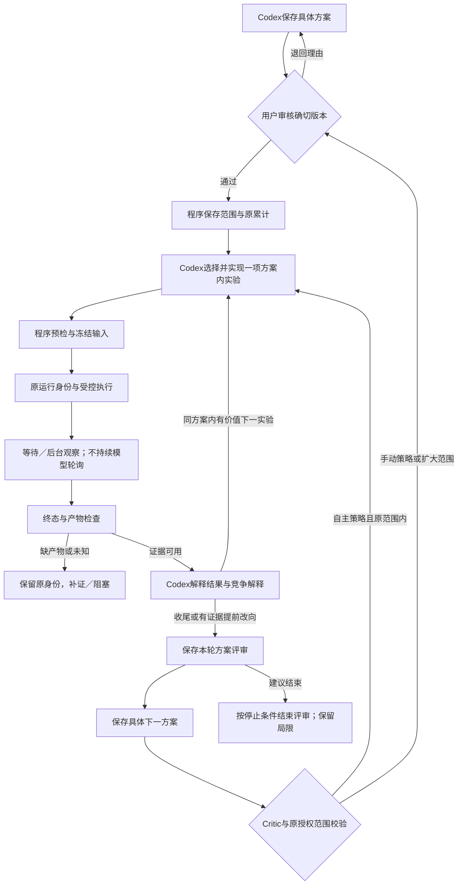

# 26项研究能力的实际承载

> 实现/设计参考，非端到端验收承诺。当前项目按[学习参考原型](preservation-status.md)留存；真实范围以[最新验收](lpai-core-acceptance-20261112.md)为准。

当前承载复核：2026-11-10。C03/C04/C06/C07/C13/C21—C23已有五类内置方法及实际文件/运行检查，方法与检查引擎一起固定版本。完整34项、14个原Skill及当前源码的对照、验证和未迁入范围见[内置研究模块](builtin-research-modules.md)。这不改变26项数量，也不将工程测试当成真实研究判断通过。

本表解释程序和Codex分别做什么。五阶段是当前研究焦点，C01—C26是职责目录；它们不各自生成工具或图谱节点，也不要求每轮全部执行。原34项完整唯一映射和8组合并的保留条件见[整合方案](capability-consolidation-20261028.md)。

原版SDM的21步设计另有[明确承接关系与基础Demo](sdm-inheritance.md)，不由26项数量推断覆盖。新增基线选择、事前确认和数值四态复用既有记录与比较器；旧项目的方法绑定不自动升级，真实研究质量仍需单独验收。

“程序”表示存在实际校验或持久对象；“判断”表示Codex依据有版本合同和真实证据决定，不能保证每个判断正确；“待迁入”不能靠提示词补齐。

| 能力 | 何时需要／输出 | 实际承载与边界 |
|---|---|---|
| C01 目标与共识 | 需求模糊或目标改变；保留已知、未知、限制 | Codex读项目文件并提关键问题；`alignment`记录和原对话分别保存，不自动补造业务事实 |
| C02 评价口径 | 方案形成／评价改变；指标、划分、目标边界 | 方案正文由Codex解释；程序固定具体版本及审批，不提供通用指标语义证明器 |
| C03 数据与泄漏 | 新数据或来源变化；真实数据审查证据 | Codex原生文件／命令检查；宿主安全路径、文件身份和输入冻结，不自动认证标签／设备独立 |
| C04 基准与对照 | 选择起点、判断是否重现；依据和真实复现区分 | 明确选择时用baseline_selection固定适用范围、真实来源及文件身份，baseline_ref保持旧引用；探索不自动选基线。新复现仍需实际运行 |
| C05 总体方案 | 起点或有证据改向；可证伪假设和具体计划 | 不可变`plan`正文、程序生成小版本；科学内容由Codex提出 |
| C06 公平协议 | 比较实验前；变化、保持、选择机会 | 复用评价合同和数值比较；confirmation_plan固定选择来源、候选/规则与新pair，核对真实候选产物。独立性和统计功效不由标签或哈希证明 |
| C07 关键语义 | 任务／异常涉及标签、损失、优化、恢复等；最小检查 | Codex结合实际代码和证据选检查；不固定“发散就降学习率”，不要求每轮穷举深度学习清单 |
| C08 质询与修订 | 初始／下一方案审核或退回；问题及修订链 | `research_reviews`保存确切版本、理由和来源，退回后另存新plan；独立B的额外研究收益尚待验收 |
| C09 资源预算 | 方案批准前；成本估计和实际累计 | 程序核验累计任务、GPU及超时；拟合事实与旧特殊边界保留后台，不要求日常另填拟合配额。预算用尽不是目标通过，未知不归零 |
| C10 工作区 | 新项目／已有工程；代码和目录归属 | `Store.create_project/safe_path`保存明确工作区；目录限制不是完整OS沙箱声明 |
| C11 环境资源 | 选执行位置／环境变化；可用与阻塞原因 | 本地解释器检查、Company官方适配、项目主开发空间及SSH验证；账号可见、绑定和训练成功分开，已支持冻结输入传输及远端受控运行 |
| C12 实现控制 | 方案内实验实现；确切代码／配置 | Codex原生工程工具与`research_write`；宿主不生成第二套工程Agent，冻结实际文件作为运行依据 |
| C13 工程验证 | 受影响代码／接口；静态与实际运行各自结果 | Codex选择检查，受控evaluation/diagnostic保存收据；代码检查通过不证明研究效果或独立评审 |
| C14 授权 | 执行具体方案及平台写操作前；确切审批 | 首次研究/GPU授权、原生权限及平台审批分别校验；自主后继经Critic及research_adopt核对原范围，不伪造用户审批或扩大授权 |
| C15 预检 | 每个正式运行；合法／阻塞 | 同一Store锁下检查当前方案、闭轮、批准、累计、未决状态和输入；确定事实不用模型反复决定 |
| C16 输入身份 | 每个正式运行；源码／数据／配置快照 | 宿主复制确切输入、分块哈希、保存request；运行中输入变更不能沿用原有效收据 |
| C17 提交身份 | 预检后；唯一运行／操作收据 | 本地受控运行、官方SDK组件创建/提交及开发空间SSH运行；未知核对原身份，不重复创建或提交 |
| C18 训练观察 | 实验运行／长任务等待；终态和现场 | 本地OwnedJob、开发空间监督器及组件后台观察；终态先回收声明的小型产物，大检查点保留索引，完整GPU多轮实测仍缺 |
| C19 指标比较 | 有真实结果；复算与公平对比 | Codex可实现复算，实际evaluation留收据；原FordA有权重重建和预测复算，不能推广成任意指标自动审计 |
| C20 专项验证 | 竞争解释确有需要；重复种子／切片／消融等 | Codex根据证据挑最有信息量一项，执行仍受同一授权；不强迫全做，也不预设下一实验答案 |
| C21 证据上下文 | 评审／续接／压缩后；有界索引和按需正文 | 简报按已有状态收起运行中/无变化记录，提供必要结果或待核对入口；完整分页与原件保留，不要求模型逐个分析全部结果 |
| C22 可复核性 | 宣称结果前；身份／叙述／指标一致 | 宿主校验路径、哈希及声明产物；语义核对由Codex／人工。签名、信任根、外部锚定和独立科学认证未迁入 |
| C23 结论局限 | 每轮结果和收尾；观察、推断、未知 | scientific_assessment按冻结数值条件计算四态，或保存有证据的研究判断；复用问题结论，追加修订，与stop_reason分开。不认证机制、因果或通用收益 |
| C24 后继与改向 | 结果改变判断或原方案失效；评审及具体下一方案 | Codex按证据选择；`rounds.py`保存当前plan→review→next plan，闭轮后旧批准不再开实验；自主策略经Critic及范围校验继续，手动策略或越界再人审 |
| C25 停止与资源 | 用户中断／停止建议／异常；实际终态与释放 | 本地仅处理自己OwnedJob；暂停阻止模型推进，不自动取消云任务。开发空间显式启停走官方接口，自动释放及账单核验不能由会话结束推断 |
| C26 归档与续接 | 阶段交接／重启／外部终态；原身份恢复 | SQLite、不可变研究Markdown、delivery及native thread；重复事件不重复投递，暂停、未知和待审不能被调度覆盖 |

## 固定程序链与研究选择的分界

外层只路由已存在事实和已授权动作，不根据loss值硬编码科学处方。本地、组件库和开发空间路径已有实现；真实GPU多轮研究仍未验收完成，详见[核心交接](core-handover.md)。模型若提前停止且没有评审／下一方案，程序会显示缺口并阻止跨轮，尚不能把这种检测声称为自动补齐研究判断的保证。

## 合并与删除说明

8组合并仅收敛职责归属和读模型；原始证据、审批、运行收据、失败和旧方法快照都保留。已移除的是新默认对“每turn先发现SDM Skill”的强依赖：替代为实际程序守卫、状态对象及有版本合同，旧模式继续严格校验。未删除原34项研究责任，也未删除未迁入的治理功能后宣称体系精简完成。
