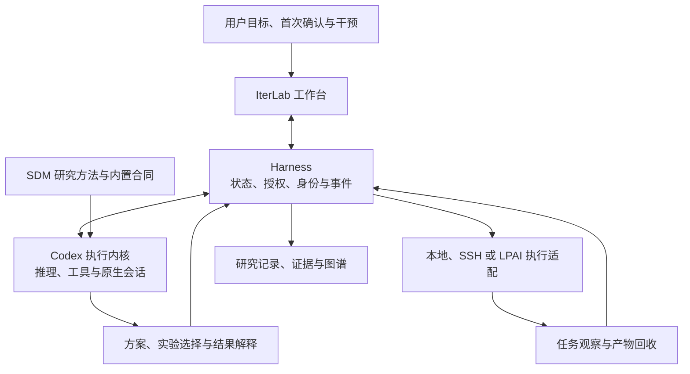

# IterLab Harness 与 BMAD ML／SDM 的定位

> 实现/设计参考，非端到端验收承诺。当前项目按[学习参考原型](preservation-status.md)留存；真实范围以[最新验收](lpai-core-acceptance-20261112.md)为准。

更新日期为2026年11月4日。本文说明产品定位、架构职责和验收标准。

本文中的 BMAD ML 指本项目此前讨论并采用的 SDM 五阶段／34项研究设计，后续已整理为26项能力。比较范围为这套本地设计及其迁移方式，功能状态以项目源码和实际验收为依据。

## 1. IterLab 正在建设什么

IterLab 是围绕 Codex 执行内核建设的机器学习研究工作台。其中，持久状态、工具接入、授权、任务监控、产物回收和自动续接等部分，属于 Agent Harness。

Harness 可以理解为让 Agent 可靠工作的运行框架。模型可以提出实验并调用工具，而研究还需要跨越排队、长时间训练、失败、服务重启和人员干预。Harness 保存过程中的身份、状态和证据，并在满足条件时恢复研究。

IterLab 还承载机器学习研究机制，包括方案与实验的两层迭代、公平比较、负结果分析、Critic 质询、版本发布和研究脉络。评价这个项目既要看任务能否可靠续接，也要看下一步研究是否有依据、是否值得执行。

## 2. 三层职责

| 层次 | 负责什么 | 项目中的承载 |
| --- | --- | --- |
| Codex 执行内核 | 理解材料、推理、编写代码、调用原生工具、管理原生会话与上下文 | Codex App Server 与原生 thread／turn |
| IterLab Harness | 持久记录、消息交付、执行边界、任务身份、后台观察、产物回收、续接及角色路由 | 本机服务、SQLite、工作区文件、研究工具及平台适配器 |
| 机器学习研究机制 | 目标与评价对齐、假设、对照实验、证据解释、方案评审和修订 | 内置研究合同、研究记录、角色职责和可选专业参考 |

原生 App Server 管理模型执行循环。IterLab 根据持久事件安排后续投递，由同一原生会话继续作出研究判断。

图中表示职责关系，各执行适配器的实际可用范围需要分别核验。

## 3. BMAD ML／SDM 与 Harness 的定位对比

| 维度 | 本项目采用的 BMAD ML／SDM 设计 | IterLab Harness |
| --- | --- | --- |
| 主要问题 | 怎样有条理地完成机器学习研究 | 怎样让研究跨工具、长任务和中断持续运行 |
| 组织方式 | 五阶段焦点、能力职责、方法和评审要求 | 持久对象、确定性守卫、事件与工具接口 |
| 主要产出 | 共识、假设、方案、实验协议、结果分析和修订理由 | 提交收据、状态、证据索引、授权记录、接续投递和恢复位置 |
| 训练失败时 | 分析原因、受影响假设和所需补证 | 保存失败身份和现场，回收材料，触发分析 |
| 长队列时 | 给出观察与停止原则 | 后台低频查询，保存状态，达到接续条件后投递 |
| 方案迭代时 | 用结果解释为何保留、修改或结束某条路径 | 绑定方案、实验、评审、版本及授权，落实执行条件 |
| 成效判断 | 实验是否公平、信息是否有价值、结论是否获证据支持 | 是否可靠提交、可恢复、可追溯，是否避免重复执行 |

两者相互配合。研究方法提出“比较前固定划分与评价口径”，Harness 保存实际协议和输入摘要，并在正式运行时核对。研究方法提出“失败后先诊断”，Harness 保存失败日志、运行身份和回收状态，使 Codex 能据此判断。

方法可以通过 Skill、文档、内置合同或专业参考提供。平台接入和运行管理适合由程序直接承担，实现形式按职责选择。

## 4. 五阶段如何融入实际研究

五阶段用于表达当前研究焦点，一个项目可以根据证据返回前面的阶段。

| 研究焦点 | Codex 作出的判断 | Harness 提供的支持 |
| --- | --- | --- |
| 需求理解 | 目标是什么，已有代码和数据能回答什么，哪些事实缺失 | 保存共识、对话及来源，维护工作区 |
| 方案设计 | 起点、假设、对照、评价和停止条件是否合理 | 固定方案与证据，管理候选评审、版本和资源授权 |
| 实施实验 | 如何实现、运行哪个实验、异常如何修复 | 输入冻结、预检、提交身份、任务观察和回收 |
| 结果评审 | 结果支持或反驳什么，竞争解释是否仍成立 | 提供本地结果、历史尝试、比较记录和证据关联 |
| 交付与决策 | 继续实验、修订方案、改向或停止是否有依据 | 保存轮次评审、后继关系、结束原因和恢复位置 |

26项能力是职责目录。一次实验按实际需要调用相关能力，图谱保存值得回看的研究动作、发现和决策。能力数量、工具数量和图谱节点数量分别管理。

## 5. 两层迭代如何工作

内层围绕当前方案开展实验。例如，固定模型路线后，依据验证结果调整学习率、正则化或容量，并用公平协议比较。路径、依赖或提交配置导致失败时，保存同一实验的多次尝试，诊断后修复重跑。

外层评审当前方案。例如，多次可复核结果表明现有表示难以利用关键时序信息，Codex 应分析其他解释，再提出改变表示或模型路线的候选。Critic 质疑改动的必要性和发版级别，通过审查后由宿主编号，随后按已授权研究范围采纳和执行。

选择哪种调整需要结合实际证据。验证集波动、数据泄漏、优化不足和模型能力不足可能产生相似表象，下一实验应尽量区分这些解释。实验的信息价值也包含推翻原判断、缩小假设范围和避免无效的大规模训练。

授权内的研究可以自动推进。申请更多 GPU 等超出已确认边界的操作，需要按产品约束重新确认。目标达成、预算边界、用户暂停、证据缺口和无进展应分别记录，并据此决定等待、补证或收尾。

## 6. 一次长训练中的职责协作

以下为预期工作方式示例，具体任务是否通过需查看实际收据。

1. Codex 结合已有代码和数据制定方案，用户确认目标、评价和资源范围。
2. Harness 核验输入、授权和执行环境，保存提交身份及平台任务 UID。
3. 排队和训练期间，后台程序查询状态。常规查询直接写入运行记录，模型在需要解释或决策时接收事件。
4. 任务结束后，回收日志、指标、预测、配置和所需检查点，按实际获得的文件建立本地清单。
5. Codex 综合本地证据分析结果，证据不完整时先处理回收缺口。
6. 当前方案内仍有有价值的实验时继续该方案。需要修改方案时提交候选，由 Critic 审议，宿主落实发布与采纳。
7. Harness 保存执行位置，服务重启后先核对原任务和投递，再决定恢复动作。

接续消息应交代发生的变化、本地证据位置、缺失项和允许处理的范围，帮助 Codex 从准确事实继续研究。

## 7. 当前实现和验收边界

当前源码包含原生会话适配、持久消息交付、研究记录与输入摘要、方案授权及自主采纳、角色交接、平台任务管理、产物回收和事件续接。主要入口为 lab/kernel.py、lab/store.py、lab/research.py、lab/autonomy.py、lab/roles.py、lab/workflow.py、lab/continuation.py、lab/lpai_training.py 和 lab/task_outputs.py。

具体运行、部署状态和真实任务验收保存在各自的本机记录中，不随共享源码分发。源码具有某项机制，并不意味着在每位使用者的模型、平台和数据上已经验证通过。

验收分别回答三个问题。

- 工程可靠性。是否正确提交、保留身份、处理未知状态、回收产物，并在重启后恢复。
- 研究判断质量。是否读取反证、提出竞争解释，选择有信息量的下一实验，避免无依据调参或频繁改向。
- 目标收益。是否在可复核且公平的评价下改善结果，收益能否覆盖成本，结论适用于什么范围。

工程回归提供程序行为的证据。Critic 的科学判断、实际自动探索和目标收益，还需要真实任务与实验结果验证。

## 8. 配套资料

- [Codex内核架构](architecture.md)
- [研究编排决定与历史演进](research-orchestration-decision.md)
- [原34项职责整合方案](capability-consolidation-20261028.md)
- 原始 SDM 迁移审阅与实网验收收据保留在开发者本机，不包含在共享源码中。
- [研究方案发布规则](plan-release-policy.md)

部分早期文档保留当时尚未实现的状态。判断当前功能时，应同时核对后续代码、部署版本和具体任务的验收证据。
