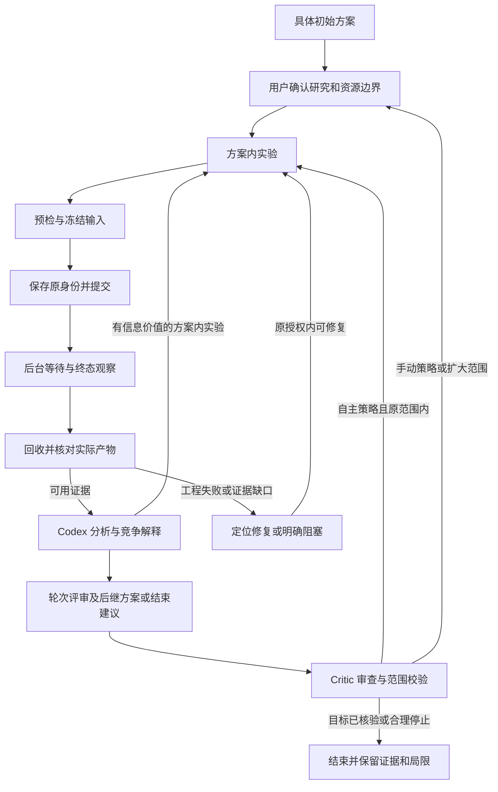

# 研究编排：程序保障，Codex 判断

> 实现/设计参考，非端到端验收承诺。当前项目按[学习参考原型](preservation-status.md)留存；真实范围以[最新验收](lpai-core-acceptance-20261112.md)为准。

当前采用 **Codex 执行内核 + 持久研究状态/事件编排 + 内置研究能力**。不是第二个 Agent 循环，也不是强制26步流水线。早期“每轮绑定 SDM Skill”和“每版人工审核”的设计已被以下实现取代；旧项目快照不静默迁移。

## 分层职责

| 层 | 承担什么 | 不承担什么 |
| --- | --- | --- |
| 原生 Codex App Server | 唯一模型/工具循环、线程、上下文压缩 | 不用聊天记忆代替持久任务身份 |
| IterLab 研究核心 | 方案、授权、版本、预检、输入冻结、运行、评审和事件 | 不硬编码科学结论或另调一套 LLM |
| 平台适配器 | 官方 SDK/CLI、SSH/本地执行、监控及回收 | 不绕过企业审批或静默本地代跑 |
| 内置合同与按需模块 | 公平比较、反证、泄漏等专业指导及实际检查 | 不把 Markdown 搬入字符串就称程序实现 |
| 可选 Skill/MCP | 专业参考、用户扩展及旧方法兼容 | 不作为每次平台操作的必读说明书 |

五阶段表示研究焦点，26项表示职责，工具接口表示动作，图谱节点表示实际研究事实；它们不是同一层对象。数量及历史合并依据见[能力目录](capability-consolidation-20261028.md)，实际承载见[能力实现](capability-implementation.md)。

## 一次确认后的探索

首次方案明确目标、数据/评价、运行位置、资源与边界，用户确认具体版本。范围内 Codex 自主选择实验、修复入口、分析结果和修订方案。普通实验不反复人工审批，但程序仍校验确切方案和实际输入。

一个方案轮次可含多个实验，末尾须保存结果依据、局限、轮次评审，以及具体后继方案或结束理由。负结果应更新判断，不能忽略反例；工程失败不能当作模型无效。可以提前评审改向，不必机械跑完旧清单。

在明确 `autonomous` 策略下，新方案经当前 Critic 审议并由 `research_adopt` 校验原授权、范围、证据、活动分支和累计后继续。模型评审不是伪造用户点击，也不新增 GPU 权限。`manual` 策略保留逐版人审。首次/增加 GPU 卡数、越出原范围及平台强制审批仍需相应确认。

工程失败、修复、重跑归属同一实验的多次尝试，不为它们发布科学新方案或展开研究分支。真正改变假设、比较协议或研究路线时才按[发布规则](plan-release-policy.md)审查。

## 确定性的外层链路

图表示合法依赖，不表示每条边都会自动成功。缺能力、缺产物、未知请求、平台审批或用户暂停不能被调度器跨过。提交不明先核对原请求；不可重复创建或用新身份清除未知。

终态先回收小型结果，再向原线程投递接续事件；不是不断告诉模型“去查一下状态”。轮询不调用模型，科学分析才使用模型。服务休眠或关闭时没有后台观察，重启从持久身份恢复，不承诺离线通知。

## 暂停、恢复和停止

用户停止 Codex 只暂停会话推进，除非明确要求，不停止云任务。系统无进展暂停与用户主动停止分别保存：前者在原授权内完成必要修复及审议后可恢复，后者不能靠自动恢复覆盖。原生请求不明时保留未知，不用文本相似或时间估计重放。

目标达成必须核验原数值合同和证据；无进展、资源不可用、预算边界及证据损坏分别报告，不以成功措辞替代。预算是防失控边界，不是“用满才结束”的目标，也不允许跨方案清零。

## 兼容和研究质量

既有方法/工具和调用证据保留确切版本，活动线程不热换方法；显式升级须空闲并记录旧/新摘要及理由。角色合同和机器交接保留审计，普通页面不把它们冒充用户新消息。

程序能核对身份、批准和文件，不等于能证明假设正确。Critic 与 Planner 同线程共享历史，不是隔离盲审；自动方案迭代也不保证指标上涨。历史CPU实验及同路线迭代只有各自条件下的局部证据；最新小型LPAI单轮、连续闭环均未通过，不能仅描述为GPU待验收。当前按学习参考原型留存，详见[核心交接](core-handover.md)。